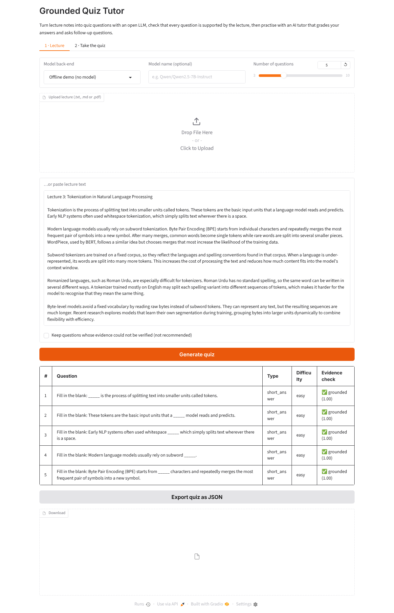

# Grounded Quiz Tutor

[](https://colab.research.google.com/github/quratulain77-saeed/grounded-quiz-tutor/blob/main/colab_demo.ipynb)

Turn lecture notes into quiz questions with an open large language model, **verify that every question is
supported by the lecture**, and practise with an AI tutor that grades answers and asks follow-up questions.



*Screenshots taken in offline demo mode.*

## Why "grounded"?

LLMs can write questions that sound right but are not supported by the source material. In an educational
setting that is a real problem: a student can be marked wrong for disagreeing with something the lecture never
said. Grounded Quiz Tutor asks the model to quote the lecture sentence behind every question, then checks that
quote against the lecture text with a fuzzy match. Questions whose evidence cannot be found are removed (or
flagged, if you choose to keep them). The same evidence is shown to the student after each answer.

This follows the idea behind my MPhil research on explainable hate speech detection: don't assume that a
model's account of its own output is faithful, check it.

## Features

- **Input:** paste text or upload `.txt`, `.md` or `.pdf` lecture notes (English and Roman Urdu examples included)
- **Quiz generation:** multiple-choice and short-answer questions at mixed difficulty, as structured JSON
- **Evidence check:** every question is matched against the lecture; ungrounded ones are filtered out
- **Conversational assessment:** the tutor grades each answer (correct / partially correct / incorrect),
  explains why, shows the supporting evidence, and asks a follow-up question to test deeper understanding
- **Open models, four back-ends:** an open model run directly with `transformers` (e.g. on a Colab GPU),
  the Hugging Face Inference API, a local Ollama (or any OpenAI-compatible server), or an offline demo mode
- **Export** the quiz as JSON

## Run on Google Colab (easiest)

Click the **Open in Colab** badge above (or upload `colab_demo.ipynb` to Colab), choose
`Runtime → Change runtime type → T4 GPU`, and run all cells. The notebook runs an open model
(`Qwen/Qwen2.5-3B-Instruct`) directly on Colab's free GPU and gives you a public link to the web app.
No API key is needed.

## Quick start (your own computer)

```bash
git clone https://github.com/quratulain77-saeed/grounded-quiz-tutor.git
cd grounded-quiz-tutor
python -m venv .venv && source .venv/bin/activate   # Windows: .venv\Scripts\activate
pip install -r requirements.txt
python app.py
```

Open http://127.0.0.1:7860. The **Offline demo** back-end works immediately with the sample lecture.

### Using an open LLM

**Hugging Face (free token):** create a token at https://huggingface.co/settings/tokens, then

```bash
export HF_TOKEN=hf_...            # Windows PowerShell: $env:HF_TOKEN="hf_..."
python app.py                     # choose "Hugging Face Inference API"
```

The default model is `Qwen/Qwen2.5-7B-Instruct`; any chat model available on the Inference API can be typed in.

**Local Ollama:** install Ollama, run `ollama pull qwen2.5:7b-instruct`, then choose
"Local Ollama / OpenAI-compatible" in the app.

## How it works

```
lecture text ──► LLM: generate questions + source quotes (JSON)
                    │
                    ▼
        grounding check (fuzzy match against lecture sentences)
                    │  keep grounded questions only
                    ▼
student answer ──► LLM: grade vs expected answer + evidence ──► feedback + follow-up question
```

| File | Purpose |
|---|---|
| `quiztutor/text.py` | loading `.txt`/`.pdf`, sentence splitting |
| `quiztutor/llm.py` | interchangeable LLM back-ends (local transformers, HF API, OpenAI-compatible, mock) |
| `colab_demo.ipynb` | Google Colab notebook: install, test, quick check, launch app |
| `quiztutor/generator.py` | prompt, robust JSON parsing, MCQ validation |
| `quiztutor/grounding.py` | evidence check against the lecture |
| `quiztutor/tutor.py` | grading, feedback and follow-up questions |
| `app.py` | Gradio web interface |
| `tests/` | unit tests (run offline with a mock model) |

## Tests

```bash
pip install pytest
pytest -q
```

## Limitations and next steps

- The grounding check verifies that the quoted evidence exists, not that the answer follows from it; an
  entailment (NLI) model would be a natural next step.
- Grading quality depends on the chosen model; small models are less reliable for open-ended answers.
- Planned: spoken questions and answers (speech-to-text / text-to-speech) for a voice-based tutor,
  and a small user study comparing grounded and ungrounded quizzes.

## Try it in Roman Urdu

`examples/roman_urdu_lecture.txt` is a short lecture on machine learning written in Roman Urdu, the informal
Latin-script Urdu used on phones and social media. Paste it into the app to see how open models handle
non-standard spelling and code-mixing, which is the problem my MPhil research focused on.

## Author

**Quratul Ain Saeed** · MPhil in Artificial Intelligence, University of the Punjab

I work on NLP for low-resource and code-mixed languages, especially Roman Urdu, and on making AI systems
explainable and trustworthy. I have also taught computer science for over six years, which is why I care
about AI tools that actually help students learn.

[GitHub](https://github.com/quratulain77-saeed) · ORCID [0009-0007-2133-4869](https://orcid.org/0009-0007-2133-4869) ·
Related work: [Roman Urdu hate speech detection](https://github.com/quratulain77-saeed/Hate-Speech-detection-in-text)

Licensed under the MIT License.
